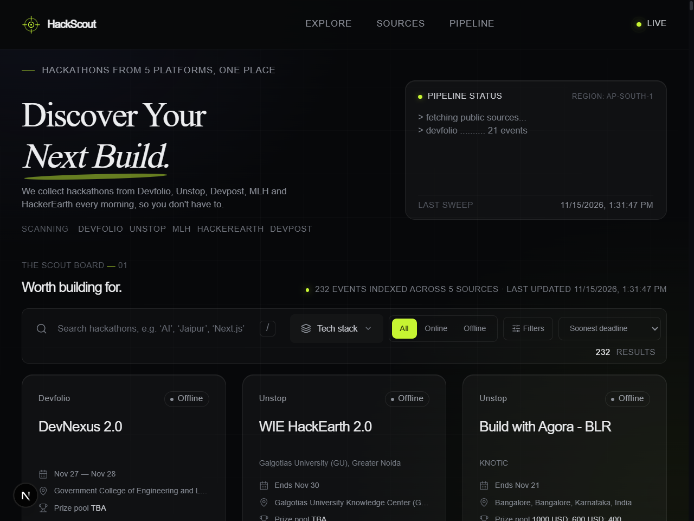
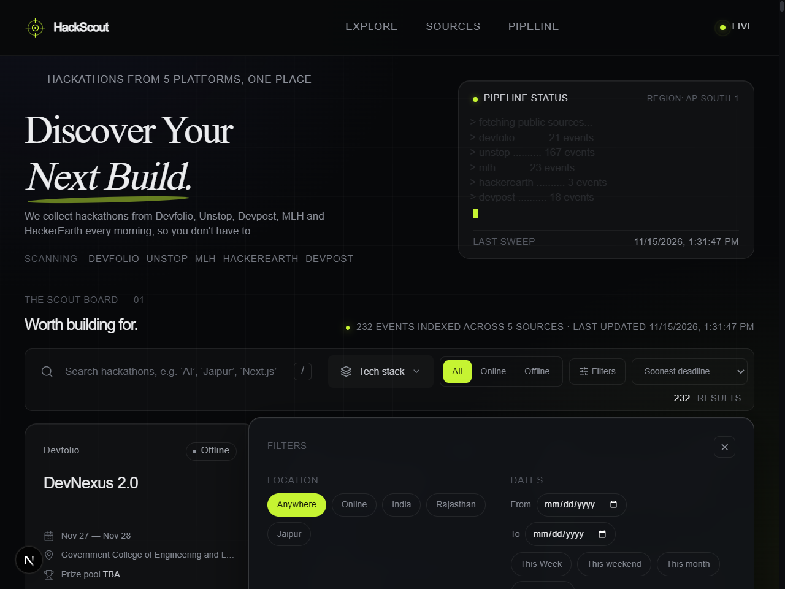

# HackScout

HackScout collects hackathons from five platforms and brings them together in one searchable dashboard.

[Live site](https://hackscout-psi.vercel.app)





## Features

- Collects hackathons from Devfolio, Unstop, Devpost, MLH and HackerEarth.
- Filters by location, dates, prize, internship, tech stack and free entry.
- Adds events to Google Calendar.
- Refreshes listings daily.

## How it works

Python scripts collect public listings, Gemini cleans and tags them, and a GitHub Action refreshes the data daily at 7:00 AM IST and commits `public/hackathons.json`. A Next.js site on Vercel serves the data.

## Run locally

```powershell
py -m venv .venv
.\.venv\Scripts\Activate.ps1
pip install -r scraper/requirements.txt
# Create .env with GEMINI_API_KEY and GEMINI_MODEL
python -m scraper.main
corepack pnpm install
corepack pnpm dev
```

## Limitations

- Data is a snapshot of the last daily run.
- Prizes can include non-cash perks.
- Some fields are missing on some platforms.

Listings belong to their platforms, and HackScout is not affiliated with them.
